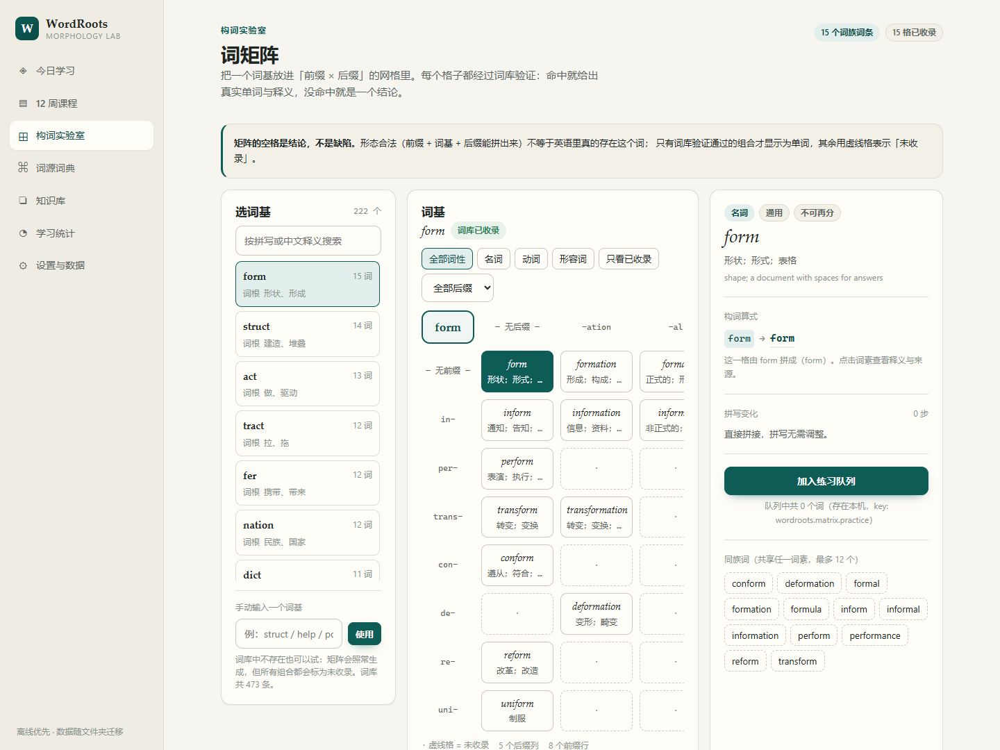
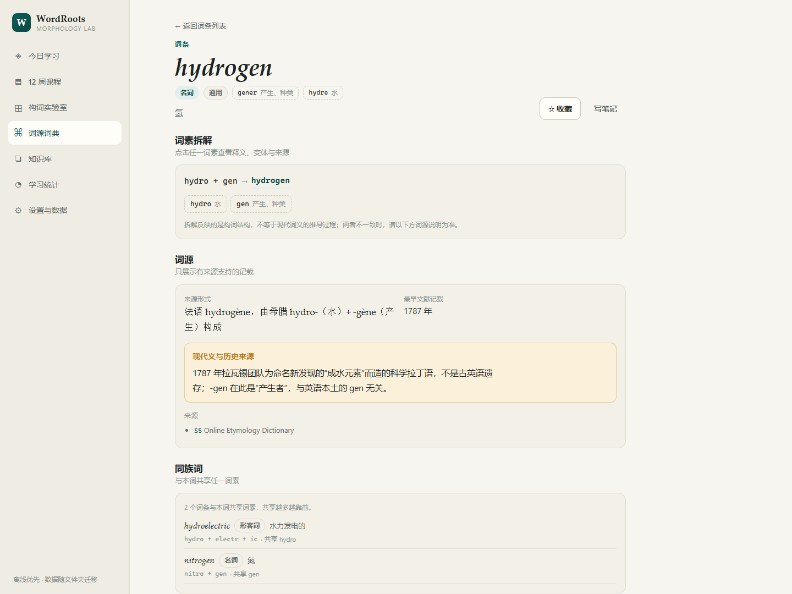
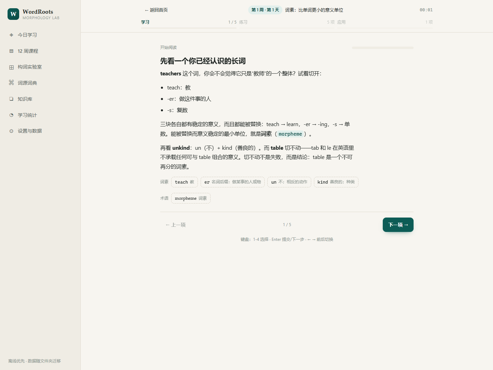
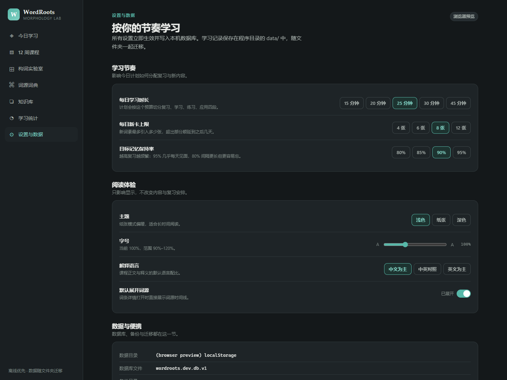

# WordRoots · 英语构词学交互学习系统

> 像理解汉字的字源一样，理解英语单词为什么这样构成。

WordRoots 是一个**离线优先的 Windows 桌面学习工具**，把英语构词学（morphology）、词源学
（etymology）、结构化词汇探究（Structured Word Inquiry）和词汇语义学组织成每天 25 分钟的课程，
并用 FSRS 间隔重复分别追踪"记忆"与"迁移推理"两种能力。

知识库（787 个词素 / 1315 个词条）按教材清单构建，课程只是它的教学顺序；两者都有可复核的
覆盖率报告，见 [`docs/TEXTBOOK_COVERAGE.md`](docs/TEXTBOOK_COVERAGE.md)。

不是背单词软件：它教的是**拆词、猜词、解释词**的方法。

## 下载

**[下载最新便携版](https://github.com/alexrwaa/Englishlearning-WordRoots/releases/latest)** ·
`WordRoots-Portable-Windows-x64.zip`（约 3 MB，v0.3.0）

解压到任意目录（支持中文与空格路径），双击 `WordRoots.exe` 即可。无需安装、无需联网、无需 Node/Rust 环境。
同一 Release 附带 `WordRoots-SHA256.txt` 用于校验。


```
WordRoots/
├── WordRoots.exe
├── data/            ← 学习数据库（随文件夹迁移，请备份）
├── courses/         ← 本版本内置的课程 JSON
├── app-data/        ← 缓存、日志
├── backups/         ← 自动备份与导出
└── README.txt
```

便携性：软件自身写入的所有数据都在 `WordRoots.exe` 所在目录内，**不写 `%APPDATA%`/文档/用户目录**。
整个文件夹复制到别的磁盘或电脑，学习记录一起走。（WebView2 运行时本身由 Windows 维护，
可能产生系统级临时文件，这不属于本软件的可控数据。）

## 界面

| 构词实验室 | 词源词典 |
|---|---|
|  |  |

| 每日学习 | 学习统计 |
|---|---|
|  |  |

| 16 周课程 | 深色阅读主题 |
|---|---|
|  |  |

## 功能

- **今日学习**：自动生成 25 分钟计划（复习 5 / 新知识 8 / 练习 7 / 应用 5），漏学不堆积。
- **电子课程**：7 种卡片（讲解、词源时间线、对照表、构词矩阵、构词算式、概念对比、英文片段），
  可点击词素查看来源，支持中文/中英/英文三种讲解模式。
- **构词实验室**：以词基为中心的 Word Matrix，组合结果**只在真实词汇中标注存在**，
  并展示去 e / y→i / 辅音双写等拼写规则的实际作用步骤。
- **Word Sum**：`un + help + ful → unhelpful`，答错会指出是词素选错还是拼写规则用错。
- **词源词典**：现代释义、词素分析、历史来源、同族词、现代搭配；明确区分历史词源与现代构词分析。
- **自适应复习**：FSRS-5 调度，记忆卡（词素/规则）与迁移卡（陌生词推理）独立评分。
- **科研英语**：机器人、SLAM、localization、LiDAR、IMU、机器学习术语的构词解析与阅读练习。
- **统计与知识库**：真实记录驱动的统计、薄弱知识定位、全文检索、笔记与收藏。

## 技术栈

React 18 · TypeScript · Vite · Tauri 2 · Rust · SQLite（rusqlite, bundled）· FSRS-5

## 本地开发

```bash
npm ci
npm run dev            # 浏览器预览（数据存 localStorage，仅供开发）
npm run typecheck
npm test
npm run validate:content
npm run tauri dev      # 需要 Rust 工具链
```

构建便携版（Windows）：

```bash
npm run build
cd src-tauri && cargo build --release --locked
pwsh scripts/package-portable.ps1
```

GitHub Actions 会在 `main` 分支构建并发布便携 ZIP（`portable-windows.yml`），
CI 负责类型检查、ESLint、单元测试、课程内容校验与无占位页检查。

## 课程结构

| 周 | 主题 |
|---|---|
| 1 | 词素、词根、词基与构词基础 |
| 2 | Word Sum、Word Matrix 与 SWI 探究 |
| 3 | 前缀及其语义功能 |
| 4 | 后缀、派生与词性变化 |
| 5 | 拉丁语词根与词族结构 |
| 6 | 希腊语词根与科学术语 |
| 7 | 复合、转换与常见构词方式 |
| 8 | 词素变体、拼写变化与读音关系 |
| 9 | 词源学、借词与词义历史 |
| 10 | 多义词、隐喻、转喻与语义扩展 |
| 11 | 技术术语、现代新词与词义推断 |
| 12 | 综合构词分析与科研英语阅读 |

现有 16 周（110 天）在 [`docs/COURSE_PLAN.md`](docs/COURSE_PLAN.md) 中定位为**第一阶段：构词学基础**；
其余阶段（拼写与形态 / 拉丁 / 希腊 / 词义演变 / 用法与变体 / 历史与借词 / 科技与综合）按教材章节排定，
尚未全部写成课时，覆盖进度以 `docs/TEXTBOOK_COVERAGE.md` 为准。

课程内容格式见 [`docs/CONTENT_SCHEMA.md`](docs/CONTENT_SCHEMA.md)。

## 课程来源与许可证

软件代码采用 **MIT License**（见 `LICENSE`）。

课程内容是基于公开语言学资料**原创撰写的中文讲解与练习**，不包含任何教材原文：

- *English Vocabulary Elements*（Oxford University Press）：仅作个人学习参考的**事实核对**来源，
  未复制、未分发其正文或 EPUB。
- *Essentials of Linguistics, 2nd ed.*（CC BY-NC-SA 4.0）：参考其形态学/语义学/历史语言学框架，
  相关章节在 `sources` 中标注；未收录原文。
- WordWorks / Structured Word Inquiry 资料：参考其探究方法与术语体系（Word Sum / Word Matrix），
  未复制讲义。
- *New Word-Analysis*（William Swinton, 1879，Project Gutenberg #19346，美国公有领域）：
  仅作历史对照，其词源结论均按现代资料复核，不与现代语言学结论等同。

详见 [`docs/COPYRIGHT.md`](docs/COPYRIGHT.md)。

## 验证状态

- CI：类型检查、ESLint、128 个单元测试、课程 JSON 校验、无占位页检查、生产构建全部通过。
- 教材覆盖率：`npx tsx scripts/coverage.ts` 现算 —— 550 个构词成分 100% 进入词素库，
  87 个（16%）已有课程讲解；283 个知识点中 71 个（25%）已映射到课时。
- Windows 构建：GitHub Actions 上 14 步全绿，包含**真实启动冒烟测试**（在含空格与中文的临时目录里
  启动 EXE，确认数据库与日志落在程序目录内、重启后仍在）。
- 本机实测：从 Release 下载 ZIP，在 `…\便携 测试\` 路径启动成功；复制整个文件夹到新路径后学习记录完整保留，
  `schema_version` 未重复迁移。
- 端到端：脚本驱动真实前端完成 3 节课（18 次作答、60 次复习评分），刷新后进度仍在。
- 详细记录与**未自动验证项**见 [`docs/VERIFICATION.md`](docs/VERIFICATION.md)。

## 已知限制

- 便携性保证的是"软件可控数据不离开文件夹"，WebView2 运行时仍由 Windows 自身管理。
- Windows 便携版在 GitHub Actions 的 `windows-latest` 上构建并进行启动冒烟测试；
  GUI 交互（点击、拖拽）无法在 CI 中自动验证，已在发布说明中标注。
- 浏览器模式（`npm run dev`）仅为开发预览，持久化使用 localStorage，不作为交付形态。
- 课程词源主张标注了来源层级；教材中个别传统词源解释存在学术争议，遇到时正文会说明"存争议"。
